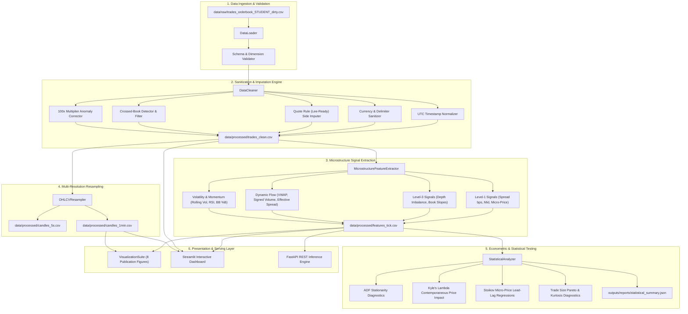

# System Architecture & Technical Specifications

**Project:** MicroQuant: High-Frequency Limit Order Book & Trade Dynamics  
**Author:** Daniel Richard Xavier  
**Version:** 1.0.0  

---

## 1. Architectural Philosophy

MicroQuant is designed as a decoupled, modular, and reproducible research and production framework for high-frequency cryptocurrency market microstructure analysis. It resolves the fragility of procedural, disconnected scripts by establishing clean separation of concerns across data ingestion, algorithmic sanitization, microstructure signal engineering, multi-resolution temporal resampling, econometric testing, and interactive visual exploration.



---

## 2. Component Design & Module Specifications

### 2.1 Data Loader (`src/data_loader.py`)
- **Responsibilities:**
  - Safely reads raw comma-separated files preserving string encodings to prevent premature float coercion.
  - Validates expected schema contracts (18 expected columns).
  - Emits structured `ValidationReport` with missing value counts, percentages, duplicate checks, and integrity flags.
  - Provides thread-safe, structured dataframe serialization.

### 2.2 Data Cleaner (`src/cleaner.py`)
- **Algorithmic Remediation:**
  - **Timestamp Harmonization:** Uses `parse_mixed_timestamp` to unify three concurrent datetime representations (Unix epoch seconds/ms, UK slash `DD/MM/YYYY`, and standard ISO-8601) into timezone-aware `datetime64[ns, UTC]`.
  - **Aggressor Side Imputation:** Implements the classic **Lee-Ready (1991) Quote Rule**:
    $$\text{Side}_t = \begin{cases} \text{buy}, & P_t \ge P_{ask, 1} \\ \text{sell}, & P_t \le P_{bid, 1} \\ \text{Tick Rule Fallback}, & P_{bid, 1} < P_t < P_{ask, 1} \end{cases}$$
  - **Crossed Book Filtering:** Purges rows where $P_{bid, 1} \ge P_{ask, 1}$ as non-executable exchange feed artifacts.
  - **Decimal Scale Rectification:** Detects pricing anomalies exceeding prevailing mid-price by ~100x via:
    $$\left| \frac{P_t / 100}{\text{Mid}_t} - 1 \right| < 0.05 \implies P_t \leftarrow \frac{P_t}{100}$$
  - **Relative Outlier Filtering:** Discards pricing records deviating by $>2\%$ from the contemporaneous mid-quote.
  - Emits an immutable `CleaningAudit` tracking exact filter cascades.

### 2.3 Microstructure Feature Extractor (`src/features.py`)
- **Level-1 Metrics:**
  - Bid-Ask Spread: $S_t = P_{ask, 1} - P_{bid, 1}$
  - Spread in Basis Points: $S_{bps, t} = \frac{S_t}{\text{Mid}_t} \times 10,000$
  - Order Book Imbalance (Level 1):
    $$OBI_{1, t} = \frac{Q_{bid, 1} - Q_{ask, 1}}{Q_{bid, 1} + Q_{ask, 1} + \epsilon}$$
  - Stoikov (2018) Volume-Weighted Micro-Price:
    $$P_{micro, t} = \frac{P_{bid, 1} \cdot Q_{ask, 1} + P_{ask, 1} \cdot Q_{bid, 1}}{Q_{bid, 1} + Q_{ask, 1} + \epsilon}$$
- **Multi-Level Depth (Levels 1 to 3):**
  - Total Cumulative Depth: $D_{total} = \sum_{k=1}^3 (Q_{bid, k} + Q_{ask, k})$
  - Decaying Depth Weighted Imbalance:
    $$W_{bid} = 0.5 Q_{bid, 1} + 0.3 Q_{bid, 2} + 0.2 Q_{bid, 3}$$
  - Order Book Slopes:
    $$\text{Slope}_{bid} = \frac{P_{bid, 1} - P_{bid, 3}}{D_{bid} + \epsilon}, \quad \text{Slope}_{ask} = \frac{P_{ask, 3} - P_{ask, 1}}{D_{ask} + \epsilon}$$
- **Dynamic Trade Flow & Volatility:**
  - Cumulative VWAP: $\text{VWAP}_t = \frac{\sum P_i Q_i}{\sum Q_i}$
  - Effective Spread: $S_{eff, t} = 2 |P_t - \text{Mid}_t|$
  - Rolling Realized Volatility: $\sigma_{20} = \text{std}(r_{t-19..t})$

### 2.4 Multi-Resolution Resampler (`src/resampler.py`)
- Transforms irregular event-time ticks into calendar-time bars ($1\text{s}$, $5\text{s}$, $1\text{min}$, $5\text{min}$).
- Aggregates Open, High, Low, Close, Total Volume, Trade Count, Buy-Initiated Volume, Sell-Initiated Volume, and Bar VWAP.
- Implements continuous forward-fill gap handling with zero-volume imputation for periods without trading activity.

### 2.5 Statistical & Econometric Engine (`src/analysis.py`)
- **Stationarity:** Augmented Dickey-Fuller (ADF) unit-root test across price levels, returns, spreads, and order imbalance.
- **Price Impact:** Kyle's Lambda regression: $\Delta P_t = \lambda \cdot \text{SignedVolume}_t + \epsilon_t$.
- **Lead-Lag Revisions:** Evaluates $(P_{micro, t} - \text{Mid}_t)$ as an econometric predictor of $(\text{Mid}_{t+1} - \text{Mid}_t)$.
- **Distribution Diagnostics:** Computes third and fourth standardized moments (skewness and Fisher excess kurtosis) and performs Jarque-Bera tests.

### 2.6 Visualization Suite (`src/visualization.py`)
- Standardized, high-DPI matplotlib/seaborn engine exporting 8 publication-grade charts to `outputs/figures/`.

### 2.7 Interactive Dashboard & API Layer (`src/dashboard.py` & `src/api.py`)
- Streamlit application providing interactive order book depth ladders, live candlestick zooming, and KPI filtering.
- RESTful FastAPI endpoints for low-latency feature extraction and backtest simulation.

---

## 3. Directory Layout & Artifact Registry

```
miniproject1/
├── README.md                      # Primary documentation, findings, and execution guide
├── LICENSE                        # MIT License with original attribution
├── pyproject.toml                 # Package definition, tool configuration, and dependencies
├── requirements.txt               # Pinned production dependencies
├── .env.example                   # Environment variable template
├── .gitignore                     # Git ignore rules for caches, artifacts, and environments
├── run_analysis.py                # Standalone root execution entrypoint
├── data/
│   ├── README.md                  # Dataset origin, schema, and anomaly dictionary
│   ├── raw/
│   │   └── trades_orderbook_STUDENT_dirty.csv  # Pristine unmodified raw dataset
│   └── processed/
│       ├── trades_clean.csv       # Sanitized and validated tick dataset
│       ├── features_tick.csv      # Augmented microstructure signal dataset
│       ├── candles_5s.csv         # 5-second OHLCV resampled bars
│       ├── candles_1min.csv       # 1-minute OHLCV resampled candles
│       └── dataset_ml_ticks.csv   # Purged walk-forward ML dataset
├── notebooks/
│   ├── 01_data_quality_audit.ipynb
│   ├── 02_exploratory_analysis.ipynb
│   └── 03_advanced_insights.ipynb
├── src/
│   ├── __init__.py                # Package metadata and public exports
│   ├── data_loader.py             # Schema validation and safe CSV loader
│   ├── cleaner.py                 # Multi-pass data cleaning & quote rule imputer
│   ├── features.py                # Level-1 & Multi-Level order book signal engine
│   ├── resampler.py               # Multi-timeframe OHLCV aggregator
│   ├── analysis.py                # ADF stationarity, Kyle's lambda, and moments
│   ├── visualization.py           # Publication-grade plotting system
│   ├── cli.py                     # Command-line interface and orchestrator
│   └── dashboard.py               # Interactive Streamlit application
├── outputs/
│   ├── figures/                   # 8 publication-ready PNG/SVG graphics
│   └── reports/
│       ├── data_audit.json        # Comprehensive cleaning funnel statistics
│       └── statistical_summary.json # Complete econometric and distribution results
├── tests/
│   ├── conftest.py                # Shared fixtures and path resolution
│   ├── test_src_pipeline.py       # Comprehensive unit tests for src/ modules
│   ├── test_cleaner.py            # Cleaner unit tests
│   ├── test_features.py           # Feature extraction tests
│   ├── test_resampler.py          # Resampling tests
│   ├── test_cli.py                # CLI runner tests
│   ├── test_api.py                # FastAPI route tests
│   ├── test_dataset.py            # ML dataset builder tests
│   └── test_backtester.py         # Strategy backtesting tests
└── docs/
    ├── REPOSITORY_AUDIT.md        # Comprehensive upstream audit
    ├── ARCHITECTURE.md            # System architecture and technical specifications
    ├── IMPROVEMENT_ROADMAP.md     # Engineering roadmap and transformation comparison
    ├── EVALUATION_REPORT.md       # Empirical benchmark and evaluation report
    ├── CHANGELOG.md               # Version history and evolution
    └── FINAL_REPORT.md            # Executive final deliverable summary
```
